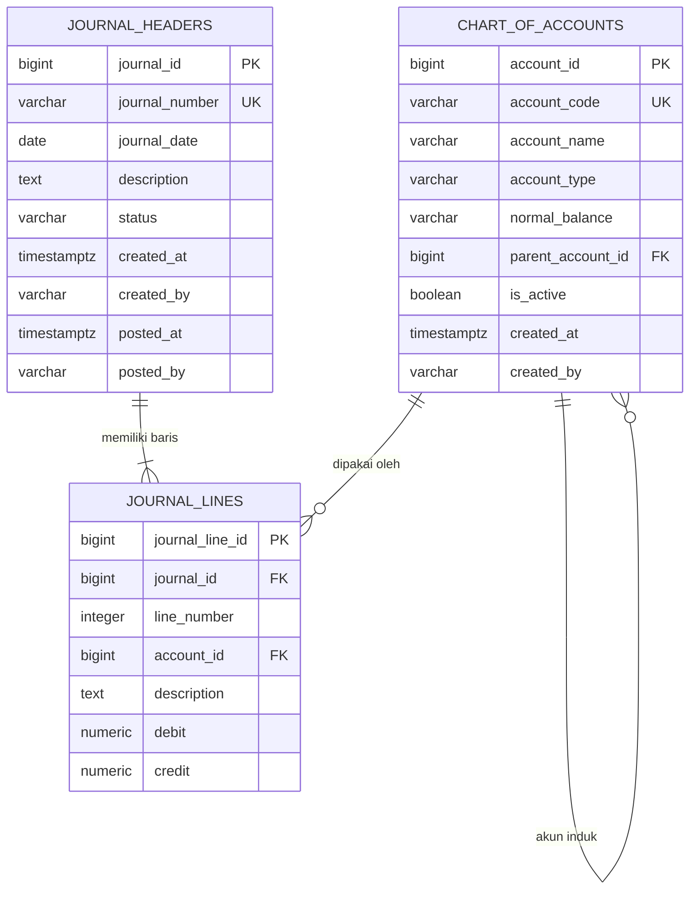

# Soal 1: Desain Database Akuntansi

## Asumsi

Desain ini mengikuti ringkasan soal yang diberikan. Satu `journal_headers` mewakili satu transaksi jurnal dan memiliki satu atau lebih `journal_lines`. Jenis akun yang digunakan adalah aset, liabilitas, ekuitas, pendapatan, dan beban. Identitas pengguna disimpan sebagai teks karena tabel pengguna tidak termasuk ruang lingkup soal.

## ERD

Relasi akun ke dirinya sendiri bersifat opsional: akun boleh menjadi akun induk atau akun detail. Setiap baris jurnal harus merujuk tepat ke satu header dan satu akun. Baris jurnal tidak dihapus otomatis jika header atau akun dihapus.

## Implementasi PostgreSQL

Jalankan [schema.sql](schema.sql) pada database PostgreSQL kosong. Skrip membuat tiga tabel, constraint, dan indeks untuk pencarian tanggal jurnal serta akun pada baris jurnal.

- `chart_of_accounts`: `account_id` sebagai PK; `account_code` unik; tipe dan saldo normal dibatasi oleh `CHECK`; akun induk memakai FK self-reference.
- `journal_headers`: `journal_id` sebagai PK; nomor jurnal unik; status dibatasi ke `DRAFT`, `POSTED`, atau `VOID`. Jurnal `POSTED` wajib memiliki waktu dan pelaku posting.
- `journal_lines`: `journal_line_id` sebagai PK; kombinasi `(journal_id, line_number)` unik; kedua FK menggunakan `ON DELETE RESTRICT`. Nilai debit/kredit tidak boleh negatif dan tepat satu sisi harus bernilai positif.

## Normalisasi 3NF

- **1NF:** setiap kolom menyimpan satu nilai atomik. Baris akun dan baris jurnal yang berulang disimpan sebagai record terpisah, bukan daftar di dalam satu kolom.
- **2NF:** setiap tabel menggunakan PK satu kolom. Atribut non-key pada `journal_lines` menggambarkan satu baris jurnal; tidak ada atribut non-key yang hanya bergantung pada sebagian kunci gabungan. Keunikan nomor baris per jurnal dijaga dengan constraint `UNIQUE`.
- **3NF:** atribut akun disimpan pada `chart_of_accounts`, atribut transaksi pada `journal_headers`, dan rincian akun serta nominal pada `journal_lines`. Nama akun tidak disalin ke baris jurnal, sehingga perubahan nama akun tidak membuat salinan data menjadi tidak konsisten. Atribut non-key bergantung pada kunci tabelnya, bukan pada atribut non-key lain.

## Audit trail dan batasan constraint

`created_at`/`created_by` merekam pembuatan akun dan jurnal; `posted_at`/`posted_by` merekam siapa dan kapan jurnal diposting. Baris jurnal tersimpan terpisah dan setiap akun yang sudah dipakai tidak dapat dihapus melalui FK. Untuk audit yang dapat merekonstruksi perubahan, aplikasi sebaiknya menambahkan log peristiwa append-only yang mencatat aktor, waktu, aksi, serta nilai sebelum/sesudah; kolom metadata pada skema ini sendiri tidak menyimpan riwayat perubahan.

Constraint `CHECK` biasa tidak dapat membandingkan jumlah debit dan kredit dari beberapa baris. Karena itu proses posting harus menghitung `SUM(debit)` dan `SUM(credit)` untuk satu jurnal dalam transaksi database, menolak jika total tidak sama atau tidak ada baris, lalu mengubah status menjadi `POSTED`. Penguncian dan larangan mengubah jurnal yang sudah `POSTED` dibahas lebih lanjut pada spesifikasi backend Soal 3.